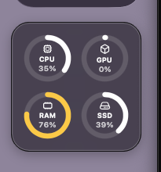
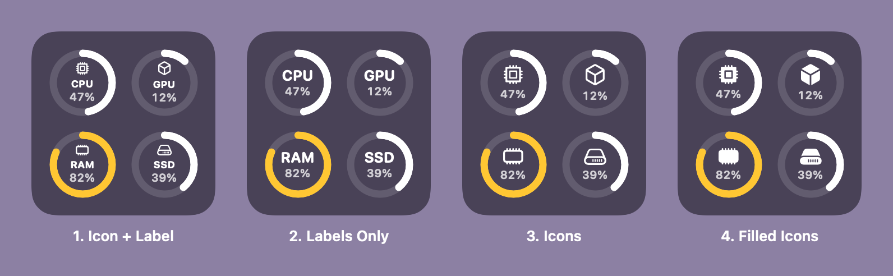

# LoadRings

A tiny desktop widget for **macOS** and **Windows** that shows how hard your computer is working — CPU, GPU, memory and disk — as rings, in the style of the macOS Batteries widget.



| Ring | What it shows |
| --- | --- |
| CPU | Share of busy time across all cores |
| GPU | GPU utilization reported by the driver |
| RAM | Memory in use |
| SSD | Used space on the system drive |

Rings are white under normal load, turn yellow above 75 % and red above 90 %. Hover a ring for exact numbers. Values refresh every 2 seconds.

## Download

Prebuilt apps are attached to each [release](https://github.com/dzotyara/LoadRings/releases):

- `LoadRings-macOS.zip` — universal (Apple Silicon + Intel), macOS 14+
- `LoadRings-win-x64.exe` / `LoadRings-win-arm64.exe` — Windows 10/11, no install needed

The builds are not signed with a paid certificate, so the first launch needs one extra step:

- **macOS:** right-click `LoadRings.app` → *Open*, or run `xattr -dr com.apple.quarantine LoadRings.app`.
- **Windows:** in the SmartScreen dialog click *More info* → *Run anyway*.

## Use

- **Drag** the widget anywhere on the desktop; its position is remembered.
- **Right-click** for *Icon Style*, *Lock Position*, *Launch at Login* and *Quit*.

There is no Dock / taskbar icon; quit from the right-click menu.

### Icon styles



## Build from source

### macOS

Requires the Xcode Command Line Tools (`xcode-select --install`); full Xcode is not needed.

```bash
cd macos
./scripts/build-app.sh
open build/LoadRings.app
```

### Windows

Requires the [.NET 10 SDK](https://dotnet.microsoft.com/download).

```powershell
cd windows\LoadRings
dotnet run
```

Single-file exe: `dotnet publish -c Release -r win-x64 --self-contained -p:PublishSingleFile=true`.

## How it works

Both versions are small borderless windows pinned to the desktop layer: they stay behind app windows and update in real time. (System widgets on both OSes are refreshed on a budget — every few minutes at best — which is fine for a battery level but useless for live load.)

| | macOS ([`macos/`](macos)) | Windows ([`windows/`](windows)) |
| --- | --- | --- |
| UI | SwiftUI + AppKit | WPF (.NET 10) |
| CPU | `host_processor_info` tick deltas | `GetSystemTimes` deltas |
| GPU | IORegistry `IOAccelerator` → `Device Utilization %` | `GPU Engine` performance counters (same as Task Manager) |
| RAM | `host_statistics64` — app + wired + compressed, like Activity Monitor | `GlobalMemoryStatusEx` |
| SSD | Free space for important usage on `/` | `DriveInfo` of the system drive |
| Settings | `UserDefaults` | `%APPDATA%\LoadRings\settings.json` |

Known limitation on Windows: *Show desktop* (Win+D) hides the widget along with other windows; it comes back when you restore them.

## License

MIT
